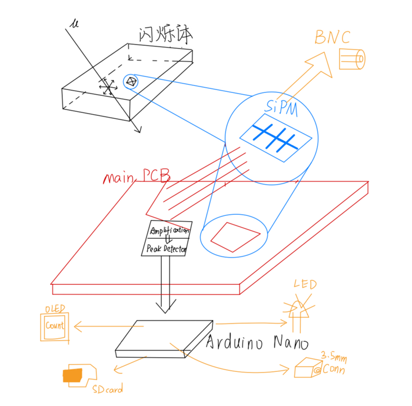
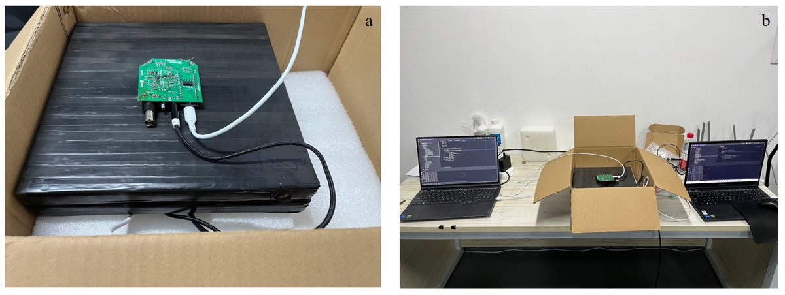
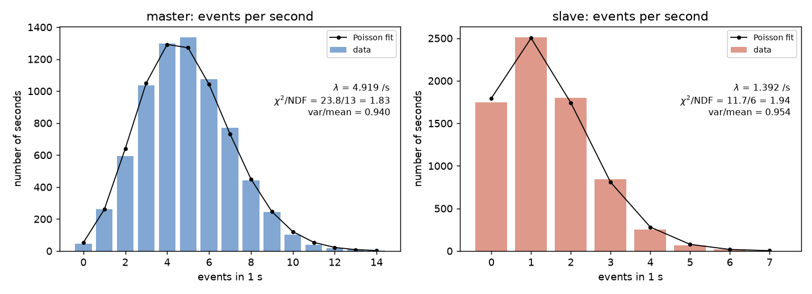
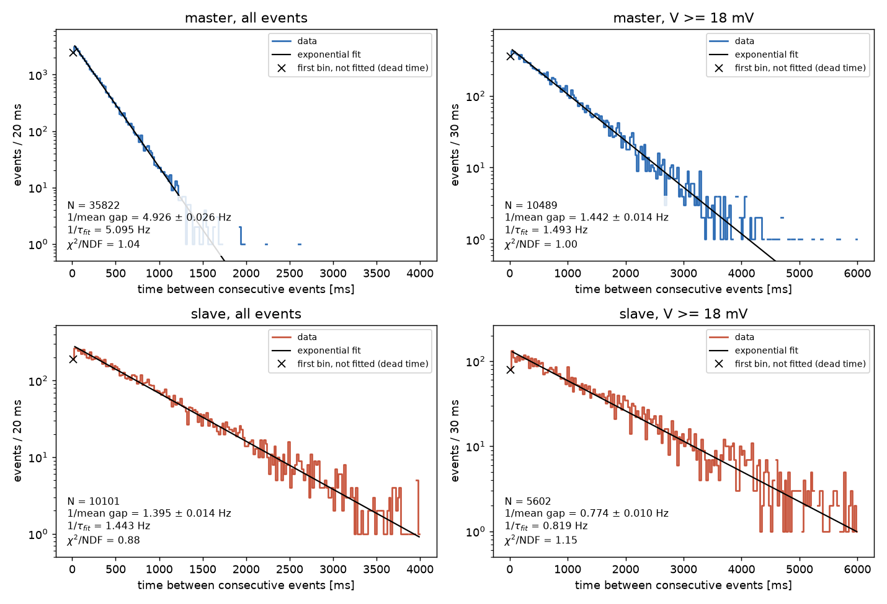
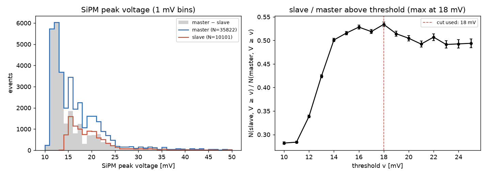

# 大气缪子实验：桌面探测器的主从符合测量与统计分析

**Atmospheric muon candidates with two CosmicWatch desktop detectors: coincidence counting, Poisson / exponential statistics and a SiPM voltage cut.**

2025 年暑期科研见习项目。用两台塑料闪烁体 + SiPM 的桌面探测器做主从符合测量，检验候选事件是否像独立随机到达的粒子，并尝试用 SiPM 峰值电压阈值压低低能背景。我参与了取数，也参与了少量装置搭建，主要负责数据分析。

- **复现**：原分析用 PyROOT 完成。本仓库用 NumPy/SciPy 重写，拟合口径与 ROOT 默认一致，原报告的数字全部复现：泊松拟合 χ²/NDF 为 1.83 / 1.94，阈值扫描的极大值在 18 mV。
- **补充检查**：重建时又做了三项检查，修正了原先的部分解读，详见[补充检查](#补充检查)。
  - 计数是欠离散而不是过度离散；
  - 时间间隔拟合的残差主要来自死时间；
  - 18 mV 的"最优阈值"在统计上并不突出。
- **数据**：两组共约 7.7 万个事件，公开前做了去标识处理，测量数值未改，见 [data/README.md](data/README.md)。

> 代码由 AI 编程助手（Claude Code）在整理时重写；分析方法、原始结论和这次补充检查的取舍由我确认。

## 装置

<p align="center">


</p>

- **探测器**：基于 [CosmicWatch](https://github.com/spenceraxani/CosmicWatch-Desktop-Muon-Detector-v2) 开源设计，闪烁体为 25×25×2 cm³ 塑料闪烁体。带电粒子在闪烁体中沉积能量发光，SiPM 把光转成电脉冲，经放大和峰值保持后由 Arduino Nano 读取。超过阈值的事件记下时间戳、ADC 值、SiPM 峰值电压、累计死时间和温度。
- **主从符合**：两台探测器上下叠放（右图）。master 记录自身所有过阈事件；slave 只在 master 触发后 15 μs 内自己也过阈时才记录。穿透性强的缪子能同时穿过两块闪烁体，而单板噪声和低能本底很难同时触发两块，所以 slave 的事件更"干净"。
- **两组数据**：run1 由探测器 A 作 master、B 作 slave，时长约 2 小时；run2 主从互换，时长约 2.7 小时。

## 分析与结果

运行 `python analyze.py` 会重新生成 `figures/` 下的全部图和 [results/summary.md](results/summary.md)。下面展示 run1，run2 的图在 `figures/run2_*.png`。

| | run1 master | run1 slave | run2 master | run2 slave |
|---|---:|---:|---:|---:|
| 事件数 | 35,822 | 10,101 | 19,217 | 12,332 |
| 计数率 [Hz] | 4.926 ± 0.026 | 1.395 ± 0.014 | 1.993 ± 0.014 | 1.275 ± 0.011 |
| 泊松拟合 χ²/NDF | 1.83 | 1.94 | 1.34 | 1.84 |
| 方差 / 均值 | 0.940 | 0.954 | 0.967 | 0.975 |
| 死时间占比 | 5.3% | 3.4% | 3.7% | 3.3% |
| 间隔拟合 χ²/NDF（含首箱 → 去首箱） | 5.26 → 1.04 | 1.11 → 0.88 | 1.41 → 0.97 | 1.15 → 0.99 |

### 1. 每秒事件数：泊松分布

把时间戳按 1 秒分箱，统计"1 秒内记录 k 个事件"的频数，用 N·Poisson(k; λ) 拟合。若事件独立随机到达，频数应服从泊松分布。



### 2. 相邻事件时间间隔：指数分布

独立随机到达过程的相邻间隔服从指数分布，在对数坐标下是一条直线，斜率给出计数率。



### 3. SiPM 电压谱与阈值筛选

- **左图**：slave 在低电压区（< 14 mV）几乎没有事件，master 在这里有一个很高的峰。符合筛选去掉的主要是低幅度信号，与"低能本底和噪声难以同时触发两块板"的预期一致。
- **右图**：对每个阈值 v，计算 slave 与 master 中电压 ≥ v 的事件数之比。原分析把比值最大的 18 mV 作为截断点；上一节时间间隔图的右列就是截断后的结果。



## 补充检查

这三点是重建时用同一份数据重新检查得到的，原报告没有涉及。

**① 泊松拟合 χ²/NDF ≈ 1.9 并不是过度离散。**
- 方差/均值在四份数据中都是 0.94–0.98，**低于 1**，属于欠离散。
- 每记录一个事件，探测器要"死"几毫秒，紧挨着的事件会丢失，计数因此比纯泊松更均匀。四份数据的死时间占比为 3–5%，方向与欠离散一致。
- χ²/NDF 偏大，一部分来自欠离散：泊松模型比数据略宽。另一部分来自 ROOT 默认的 Neyman χ²：它以观测值的平方根作误差，频数小的尾部箱会被放大。
- 单元测试用带死时间的模拟数据复现了"方差/均值 < 1"。这里只做到定性解释，没有建立精确的死时间模型。

**② 时间间隔拟合的残差集中在第一个箱。**
- run1 master 全部箱一起拟合时 χ²/NDF = 5.26，其中约 60% 来自 0–20 ms 这一个箱：观测 2475，模型 3314。数据中最短的间隔是 5 ms，同样是死时间造成的。
- 去掉第一个箱后 χ²/NDF = 1.04，剩余部分是很好的指数分布。
- 指数斜率给出 5.10 Hz，比"1/平均间隔"的 4.93 Hz 高约 3%。量级与死时间造成的计数损失相当。

**③ 18 mV 的"最优阈值"在统计上并不突出。**
- run1 中，比值在 14 mV 以上基本是一个平台：
  - 18 mV 时为 0.534 ± 0.005，16 mV 时为 0.528 ± 0.004，两者相差约 1σ；
  - 而且相邻阈值共用大部分事件，误差并不独立。
- 主从互换后的 run2 里，比值先降后升：14 mV 处最低，之后一路升到扫描上限 25 mV，范围内没有极大值。
- 所以 18 mV 只是 run1 上的一个经验点，可以说明"去掉 14 mV 以下的低幅度信号"有效，但不能当作可迁移的最优参数。

## 局限

- **粒子身份无法逐事件确认**：没有能量定标（电压 → 能量），也没有屏蔽对照，所以只能称为"缪子候选事件"。
- **两台探测器的时钟各自独立**，时间戳不能逐事件对齐，无法直接检查每个 slave 事件对应哪个 master 事件。
- **阈值扫描的比值不是严格的二项比例**：slave 和 master 的电压来自不同的探测器。误差棒按二项近似给出，只作量级参考。

后续可以做的事：用多块板测天顶角分布，用铅板屏蔽做对照，用 MIP 峰做电压–能量定标，以及把温度与计数率做关联分析（数据中已有温度列）。

## 复现

```bash
pip install -r requirements.txt               # numpy, scipy, matplotlib
python analyze.py                             # 重新生成 figures/ 和 results/summary.md
python analyze.py --runs run1 --cut-mv 16     # 换一个截断电压
python -m unittest discover -s tests -t .     # 7 项测试，用已知参数的模拟数据检验拟合
```

## 仓库结构

| 路径 | 内容 |
|---|---|
| `analyze.py` | 入口：读取数据、拟合、作图、写汇总表 |
| `muon/io.py` | 读取事件表并做基本校验（列齐全、时间单调） |
| `muon/stats.py` | 每秒计数与泊松拟合、间隔指数拟合、死时间占比、阈值扫描 |
| `muon/plots.py` | 三类图 |
| `tests/` | 在已知计数率和死时间的模拟数据上检验以上方法 |
| `data/` | 两组主从测量的事件表及字段说明 |
| `figures/`、`results/` | `analyze.py` 的输出 |
| `docs/` | 装置示意图与照片 |
